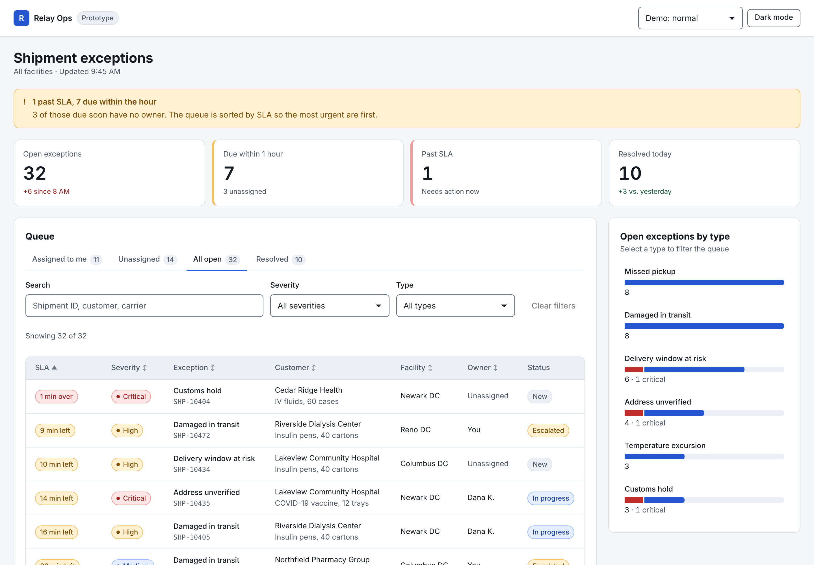
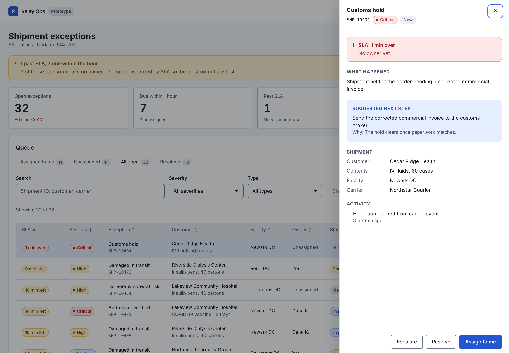
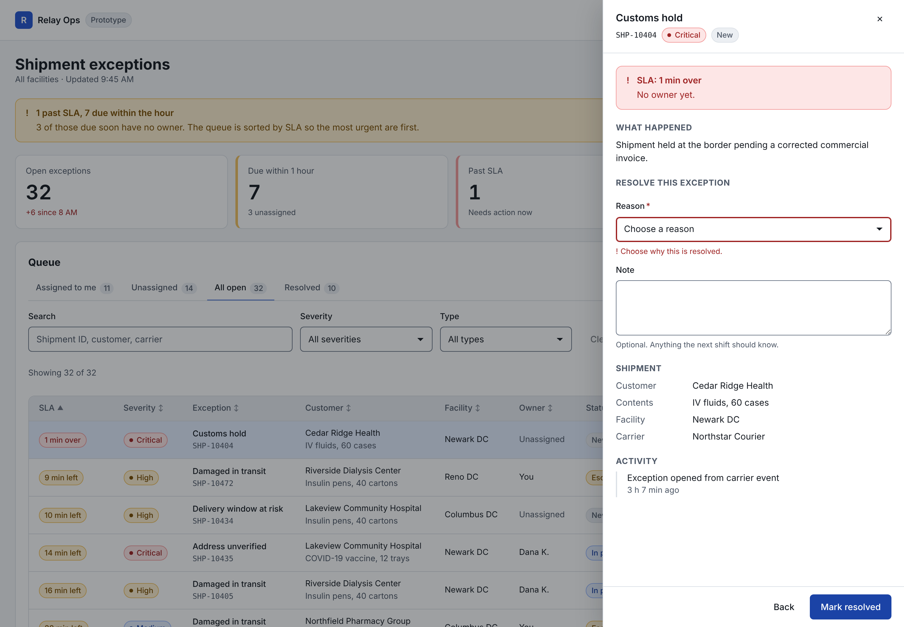
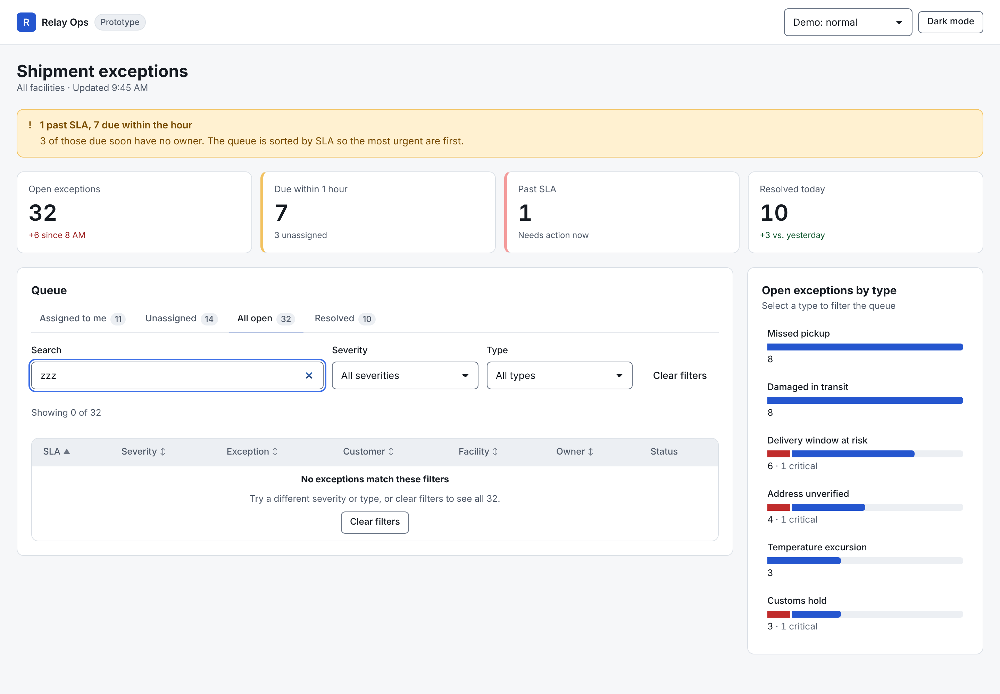
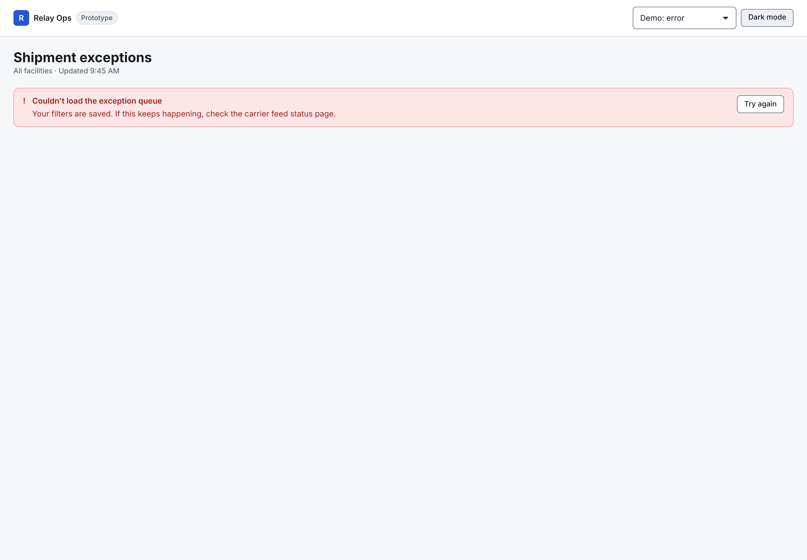
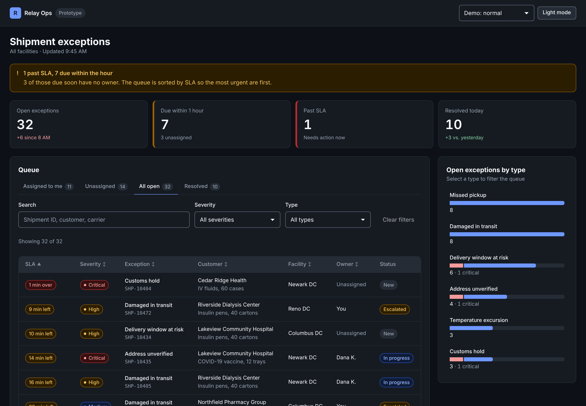
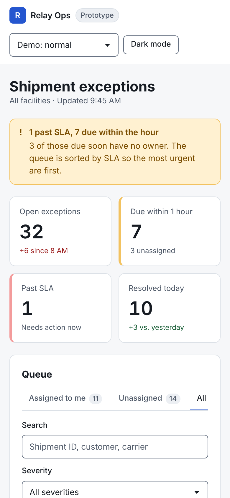

# Relay Ops: shipment exceptions prototype

An interactive prototype of an operations console. Coordinators use it to triage problems with medical supply shipments (temperature excursions, missed pickups, customs holds) before they turn into missed deliveries at hospitals.

**[Open the live prototype](https://holliej0.github.io/ops-console-prototype/)** · Built on the [Relay Design System](https://github.com/holliej0/relay-design-system)



> All companies, hospitals and shipments are fictional. Data is generated from a fixed seed so the demo looks the same every time.

## The problem

An exceptions coordinator starts a shift with dozens of open issues across several warehouses. Some are urgent (vaccines sitting outside their temperature range), most are not. The hard parts are:

1. **Knowing what to work on first.** Severity and deadline both matter, and they don't always agree.
2. **Not dropping ownership.** Unassigned issues that are about to breach their SLA are the most dangerous ones.
3. **Acting without losing context.** Opening an issue shouldn't mean losing your place in the queue.
4. **Leaving a trail.** The next shift needs to know what was done and why.

## Key design decisions

- **Sort by time left, not by severity.** The queue opens sorted by SLA. A "Medium" issue that breaches in 10 minutes needs attention before a "Critical" one with 5 hours left. Severity is still one click away.
- **Say the urgent thing first.** A summary alert at the top answers "how bad is it right now?" in one line: how many are past SLA, how many are due within the hour, and how many of those have no owner.
- **Time in words.** "1 h 35 min left" and "15 min over" instead of a timestamp to subtract in your head, with color as a second signal.
- **Details in a side panel.** The queue stays visible behind the panel, so you can work through issues one after another. The panel traps focus, closes with Escape, and returns focus to the row you came from.
- **A suggested next step, with the reason.** Each exception type has a simple, visible playbook rule ("Quarantine the shipment and request a stability review"), plus why. It is a rule, not a black box, so people can judge it.
- **Friction only where it protects people.** Assigning is one click. Resolving requires a reason, and "Other" requires a note. Escalating requires a note that says who needs to act. Every change can be undone from the confirmation message.
- **The chart is a filter.** "Open exceptions by type" bars are buttons. Clicking one filters the queue, so the chart is a way in, not just a picture. Critical counts are shown in the label, not only in color.
- **Every state is designed.** Loading, empty queue, no filter results and load errors each say what happened and what to do next.

| Detail panel | Validation |
|---|---|
|  |  |

| No results | Load error |
|---|---|
|  |  |

| Dark mode | Mobile |
|---|---|
|  |  |

## Try it

- Click or press Enter on any row to open it. Try **Assign to me**, **Resolve** (submit it empty to see validation) and **Escalate**, then **Undo**.
- Click a bar in **Open exceptions by type** to filter.
- Use the **Demo** menu in the header, or add `?demo=loading`, `?demo=error` or `?demo=empty` to the URL, to see the other states.
- Switch to dark mode in the header.

## Run it locally

```bash
npm install
npm run dev        # http://localhost:3000
npm run build      # static export to /out
```

Node 20 or newer. Stack: Next.js (App Router, static export), React, TypeScript. The components and tokens come from [relay-design-system](https://github.com/holliej0/relay-design-system), copied into `design-system/` so this repo runs on its own.

## What was checked

- Keyboard only: rows, tabs, filters, the panel and its forms all work without a mouse, with a visible focus ring.
- Focus management: focus moves into the panel when it opens and back to the row when it closes.
- Screen reader basics: labeled fields, errors tied to their inputs, live status messages, real table markup with `aria-sort`.
- Color contrast: every token pairing passes WCAG 2.2 AA in light and dark (see the contrast script in the design system repo).
- Small screens: no horizontal page scroll at 390px wide. The table scrolls inside its card.

## Limitations and what I'd do next

- **Not tested with real coordinators yet.** The biggest open question is whether "sort by time left" matches how people actually triage. I'd test it against a severity-first version with 5 or 6 coordinators.
- No real backend: changes live in memory and reset on reload.
- No bulk actions. Coordinators often reassign a batch at shift change, so that's next.
- The playbook rules are simple placeholders. In a real product they would come from the operations team and be versioned.
- On phones, the table works but isn't ideal. A card list would read better below about 600px.

## How it was built

Built with an AI coding agent (Claude) working from my brief. What the agent produced, what got corrected in review, and how the result was checked are written up in [ai-design-experiments](https://github.com/holliej0/ai-design-experiments).

Made by [Hollie Richmond](https://hollierichmond.com). MIT license.
